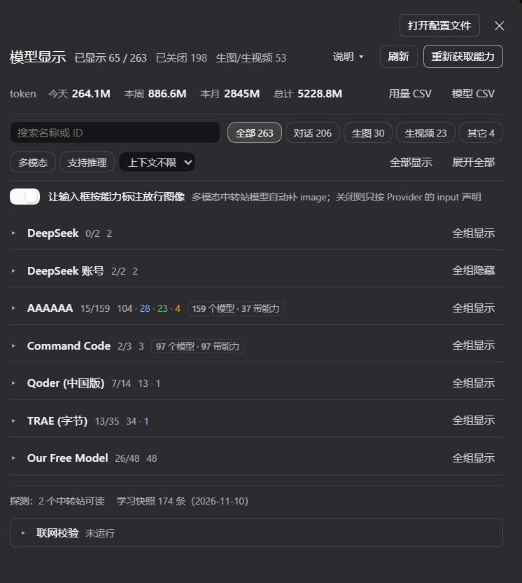
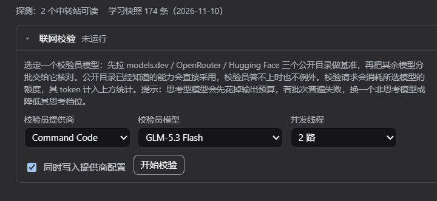

<div align="center">

# 模型显示

**让 DeepSeek Harness 的模型菜单更干净，让每个模型的能力更清楚。**

显示或隐藏模型 · 辨认真实能力 · 手动修正声明 · 让多模态模型真正能发图

[](LICENSE)
[](package.json)
[](test)

[安装](#安装) · [使用指南](#使用指南) · [能力来源](#能力来源与可信度) · [联网校验](#联网校验) · [故障排查](#故障排查) · [开发文档](HANDOVER.md)

</div>

---

## 它解决什么问题

DSH 的标准模型目录主要提供模型 ID、名称与推理档位。对于自定义中转站，未填写的 `input` 经常回退为 `defaultInput: [text]`，于是可能出现：

- 模型菜单混有生图、生视频、嵌入等不需要的条目；
- 实际支持图片的模型被标成纯文本，发送图片时被拒绝；
- 上下文窗口、输入模态和推理档位难以辨认；
- 不同中转站对同一个模型的声明不完整，甚至互相矛盾。

这个插件把模型清单变成一个**可筛选、可解释、可修正的管理页面**，同时保留官方模型选择器及其推理档位控件。

## 界面



*设置 → 模型显示。上图为真实使用环境，模型数量与用量来自用户配置。*

## 功能一览

| 功能 | 说明 |
| --- | --- |
| **逐模型开关** | 隐藏的模型立即从对话输入框的模型菜单消失；当前会话正在使用的模型仍保留，避免触发器丢失名称。 |
| **分组管理** | 按 Provider 分组，支持整组显示/隐藏、折叠/展开；筛选时只处理筛选结果。 |
| **搜索与筛选** | 按名称或 ID 搜索；按类型、多模态、推理能力和最小上下文窗口组合筛选。 |
| **能力标签** | 展示模型类型、输入模态、上下文窗口、推理能力与档位；实线表示声明，虚线表示补全或推断。 |
| **手动覆盖** | 为单个模型编辑类型、模态、上下文和推理档位；可只保存在本插件，也可写回 Provider 配置。 |
| **图像放行** | 默认开启。对判定支持图像的中转站对话模型，在内存中补充 `image`，同时覆盖发送准入和请求序列化。 |
| **联网校验** | 汇总公开目录，再由用户选择的校验员模型补充能力信息；支持分批、并发、取消和失败诊断。 |
| **用量统计** | 显示今天、本周、本月与保留窗口内的合计 Token，支持用量和模型清单 CSV 导出。 |
| **持久化恢复** | 隐藏列表、手动覆盖、学习快照与账本缓存分别保存在 `$DSH_HOME/dsh-model-visibility/`。 |

## 安装

### 插件市场

打开 [awesome-dsh-plugin 中的插件页](https://awesome-dsh-plugin.com/p/TZYCeng/dsh-model-visibility/)，按市场流程安装。

### DSH `plugin_manager`

```text
install_bundle  target = @tzyc/dsh-model-visibility
```

也可安装最新 Release 包：

```text
https://github.com/TZYCeng/dsh-model-visibility/releases/latest/download/dsh-model-visibility.tgz
```

### 本地开发

```powershell
git clone https://github.com/TZYCeng/dsh-model-visibility.git
cd dsh-model-visibility
npm install
npm test
npm run build
```

在 DSH profile 中链接此目录。安装或更新后刷新页面；Host 代码更新时需要重新加载 Host 或重启 DSH。

> npm 包名是 **`@tzyc/dsh-model-visibility`**。不带作用域的 `dsh-model-visibility` 是另一个项目。

## 使用指南

### 清理模型菜单

1. 打开 **设置 → 模型显示**。
2. 用搜索或类型筛选找到目标模型。
3. 关闭单行开关，或使用「全组隐藏」批量处理。
4. 回到对话输入框，确认模型菜单已更新。

「全部显示」会清空隐藏列表；「折叠全部」只改变页面的阅读状态，不改变模型可见性。折叠偏好保存在浏览器 `localStorage`，不会同步到 Host。

### 修正能力声明

点击模型行的「编辑」，可设置：

- 类型：对话、生图、生视频、嵌入、重排、音频、审核、翻译；
- 输入模态：文本、图像、音频、视频、文件；
- 上下文窗口；
- 推理档位及默认档，或明确声明不支持推理。

留空并保存等价于删除本地覆盖，恢复自动识别。

勾选「同时写入模型提供商设置」后，`input`、`contextWindow`、`reasoningEfforts` 会通过 `settings.mutate` 写入现有模型条目。成功写回的字段会从本地覆盖移除，避免同一事实保存两份。

> 「恢复自动」不会撤销已经写进 Provider 配置的值。要撤销写回，请到模型提供商设置中修改对应字段。

### 让多模态模型接收图片

保持「让输入框按能力标注放行图像」开启即可。插件只包装符合 pi-ai 形状的适配器，且只处理中转站对话模型的 `image` 输入：

- 显式 Provider 声明优先；
- 不修改路由配置文件；
- 关闭开关或卸载插件后恢复；
- 不会让音频、视频或文件绕过 DSH 的准入限制。

### 刷新与重新获取能力

- **刷新**：绕过能力快照与中转站探测的 TTL，但会复用正在进行的读取。
- **重新获取能力**：使能力、探测、覆盖和图像准入缓存失效，丢弃旧的进行中结果，再重新读取；不会改变隐藏开关。

适配器没有公布的推理档位无法靠刷新凭空产生。可先手动补充，或联网校验后写回 Provider，再重新加载 Host。

## 能力来源与可信度

每个字段独立合并，不是整条记录只选一个来源。

| 优先级 | 来源 | 页面含义 |
| --- | --- | --- |
| 1 | `manual` | 用户手动声明；始终优先。 |
| 2 | `config` | Provider 或模型条目中显式配置的能力。 |
| 3 | `adapter` | 内置适配器或非配置列表模型的适配器声明。 |
| 4 | `provider` | 中转站 `/models` 或 `/api/pricing` 返回的能力。 |
| 5 | `snapshot` | 联网校验保存的学习快照；以虚线显示。 |
| 6 | `inferred` | 根据明确的模型家族名称推断；以虚线显示。 |
| — | `unknown` | 没有足够证据，保持未知。 |

`official` 是独立的厂商文档校正层：可修正中转站、快照或名称推断中的错误，但不压过用户的显式配置和内置适配器声明；`manual` 始终最高。

**重要边界：** `input: []` 表示未声明，不等于纯文本；`defaultInput: [text]` 也不会被当成模型真实能力的证明。

## 联网校验



### 工作流程

1. 无需密钥地读取公开目录：
   - `models.dev/models.json`
   - `models.dev/api.json`
   - OpenRouter `/api/v1/models`
   - Hugging Face `/api/models`，支持国内镜像回退
2. 按归一化模型 ID 合并公开事实。
3. 选择支持工具调用的「校验员」模型。默认开启联网搜索：校验员可实际调用 `search_model_docs` 搜索模型模态、上下文与推理规格，并通过 `read_model_doc` 读取搜索返回的文档。
4. 保存结果到 `learned.json`，同名模型可跨路由复用。
5. 「同时写入提供商配置」默认关闭；主动勾选后才将可映射字段写回对应 Provider。已明确保存的旧选择会保留。

默认每批 6 个模型、2 路并发，面板可选 1–8 路。联网沿用 DSH 当前搜索/网页读取服务，**可能消耗联网服务额度和模型 Token**；Token 计入账本，搜索/读取调用数单独显示。未配置可用联网服务、模型不支持工具调用或拒绝搜索时会报告错误，可关闭联网后使用保守的离线补全。

进度条统计「已处理」，同时分别列出有效、未知和失败数。即使只有 175 个模型获得信息，其余模型也会计入已处理并正常结束；未知不会被伪装成有效结果。运行时可看到批次模型 ID 和当前阶段。

### 这不是实际请求测试

联网模式下，校验员依据搜索摘要与可选的文档原文给出结果，**不等于插件真的向目标模型发送图片或测量上下文长度**。结果中的 `evidence` 保存 URL 与其支持的字段；代码只接受本批次检索返回的 URL，并删除没有引用支持的字段。这个检查能阻止虚构地址，仍不能自动证明引用内容与结论完全一致。关闭联网时依据公开目录和模型知识保守补全。

因此：

- 把学习快照视为**可修正的参考信息**，不要视为不可变事实；
- 开启写回前，先检查重要模型的结果；
- 对关键模型，仍应手动发送一次图片或查看厂商文档；
- 较旧的校验批次只能补充空缺，不能覆盖较新的能力声明。

### 失败处理

- 输出预算为 8192 Token；只有模型声明支持时才使用低思考档位；
- 联网输出固定为 JSON 数组；逐项检查 ID、字段、枚举、数值、推理一致性及引用，必要时携带格式错误定向重试一次；
- 失败批次会二分重试，单侧失败仍保留健康侧结果；请求默认 180 秒超时，校验批次总预算 360 秒，搜索/读取每次最多 30 秒，每次工具会话最多 5 轮、12 次调用；
- 公开目录即使在校验员无答案时，也能独立落库；
- 取消会等待旧 worker 退出，避免两轮任务同时写状态；
- 插件卸载会取消并等待校验任务，不会在后台继续落库。已提交给宿主的 Provider 配置写入无法撤销，取消只阻止后续写入；

## Token 用量与 CSV

插件读取 `$DSH_HOME/sessions/**` 中的会话日志，按天和路由折叠输入、输出、缓存读写 Token。

- 当前月份按事件日期统计；
- 较早历史按会话创建日期粗略归集；
- 缓存保留最近约 **14 个月**，所以「总计」不是无保留的全历史财务账单；
- 修改过的日志目前会重新解码该文件，未变化的文件复用缓存；
- 校验自身的消耗也计入总量。

CSV 会转义分隔符、引号与换行，并防护表格公式注入。

## 数据与隐私

| 数据 | 位置 |
| --- | --- |
| 隐藏列表 | DSH 设置 + `$DSH_HOME/dsh-model-visibility/hidden.json` |
| 手动覆盖 | `overrides.json` |
| 学习快照 | `learned.json` |
| 用量缓存 | `usage-ledger.json` |
| 折叠、说明和校验员选择 | 浏览器 `localStorage` |

- 凭据只在 Host 内解析，用于请求对应 Provider；不写入插件文件、不返回浏览器、不记录到诊断。
- 中转站探测仅允许 HTTPS；HTTP 只放行 localhost、127.0.0.1 和 ::1。
- 请求不跟随重定向，避免把认证头带到其他域。
- 中转站响应限制 4 MiB，公开目录限制 16 MiB，按实际字节流读取，超限即取消。
- 多份数据文件是全局的，不按 DSH profile 隔离；不建议多个 Host 实例同时写同一份文件。

关闭中转站探测：将插件配置设为 `probe: false`，或设置环境变量 `MODEL_VISIBILITY_PROBE=0`。

## 故障排查

| 现象 | 建议 |
| --- | --- |
| 页面退回基础模型目录 | Host 路由尚未加载或读取失败。重新加载 Host/重启 DSH 后，再点「重新获取能力」。 |
| 模型仍显示纯文本 | 检查 Provider 是否显式配置了 `input: [text]`；必要时用「编辑能力」修正。 |
| 页面显示多模态但仍不能发图 | 确认放行开关已开启、路由属于 pi-ai 中转站，并重新加载 Host；再用真实小图验证。 |
| 推理档位为空 | 适配器未公布该信息。手动配置或校验后写回，再重新加载 Host。 |
| 中转站显示读取失败 | 悬停分组徽标查看 DNS、超时、鉴权或 TLS 诊断；`/api/pricing` 返回 403/404 属常见降级。 |
| 校验批次失败 | 查看面板的真实错误；换非思考型校验员、降低并发，或稍后重试。 |
| 隐藏列表在重装后恢复 | 删除 `hidden.json` 可重置；该文件正是用于跨 profile 修复和插件重装恢复偏好。 |

更多已知约束：只处理 pi-ai 的图像准入；官方校正是手工维护的小表；冷门模型仍需手动补充；大规模会话日志的首次扫描可能耗时数秒至数十秒。

## 开发与测试

```powershell
npm test          # 217 个自动化测试
npm run build     # client-src/*.mjs → client.js
npm pack --dry-run
```

浏览器源码位于 `client-src/`，`client.js` 是构建产物，不要直接手改。Host 与核心逻辑位于 `index.js` 和 `lib/`。

架构、接口契约、修改指引、验证与发布清单见 **[HANDOVER.md](HANDOVER.md)**。

## License

[MIT](LICENSE)
