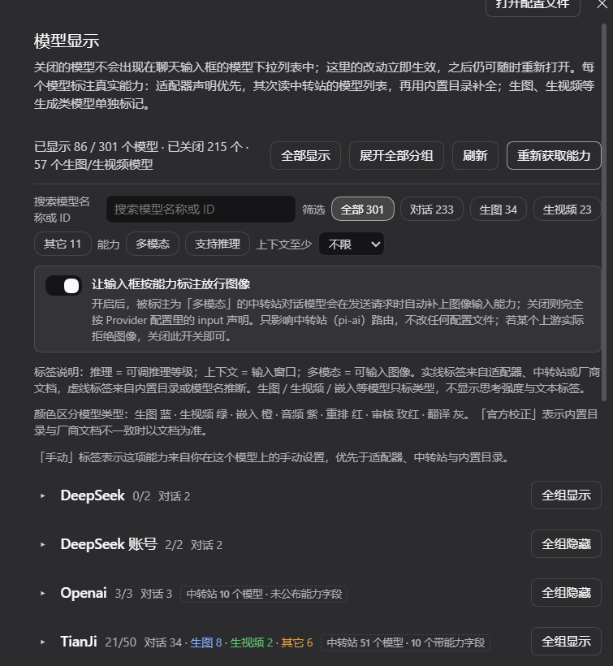
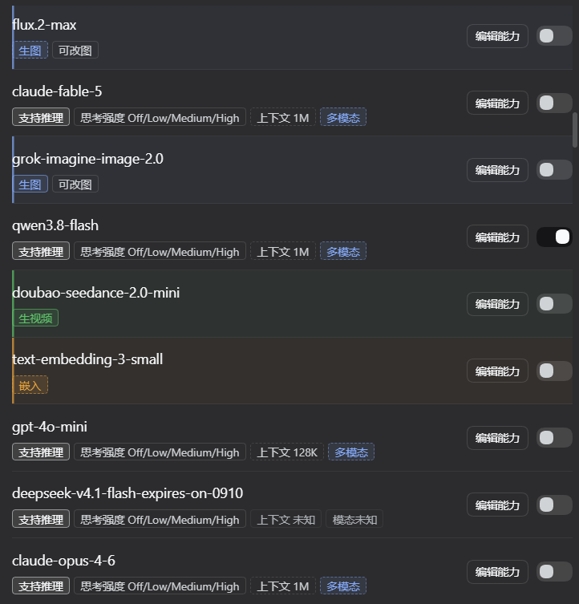

<div align="center">

# 模型显示 · dsh-model-visibility

**在 DeepSeek Harness 里，把「模型菜单」变成一张看得懂、改得动、发得出图的清单。**

每个模型一个开关 · 每个模型标注真实能力 · 想改就改，想发图就发图

[](LICENSE)
[](package.json)
[](test)
[](https://github.com/TZYCeng/dsh-model-visibility/releases)
[](https://awesome-dsh-plugin.com/p/TZYCeng/dsh-model-visibility/)

</div>

> **In English:** a DeepSeek Harness bundle that adds a *Settings → Model visibility* page. Every model of every provider gets a switch (off models vanish from the composer's model menu), and every remaining model is labelled with what it can actually do — reasoning support and the reasoning-effort levels the adapter publishes, context window, input modalities, and whether it is a chat, image, video, embedding, rerank, audio, classifier or translation model. The list can be searched by name or ID, filtered by kind, by capability (multimodal, reasoning) and by minimum context window, and provider groups can be collapsed. Labels merge the sources in priority order (manual override, settings document, adapter, the relay's own `GET /models`, a learned local snapshot seeded online, vendor corrections), the page names the source on hover; the page names the source on hover, with solid borders for declared values and dashed for inferred ones. Any model can be edited by hand — kind, context window, modalities, effort levels — and those edits can be written back into the model provider's own settings. A switch, on by default, makes relay routes whose models declare text-only input accept images in memory, without editing any configuration file. A token-usage strip (today / week / month / total) with two one-click CSV exports lives at the top of the page, and an online verification panel re-checks every routable model's capabilities. The rest of this README is in Chinese.

<p align="center">
  
  
</p>

<p align="center"><sub>左：设置 → 模型显示（分组、统计、筛选、图例、图像放行开关）　右：模型行（类型、能力标签、编辑入口）</sub></p>

**目录** · [为什么](#为什么需要它) · [功能](#功能) · [安装](#安装) · [界面](#界面速览) · [能力来源](#能力标注从哪里来) · [手动覆盖](#手动覆盖能力) · [官方校正](#官方校正) · [图像放行](#让输入框真的能发图) · [探测](#中转站探测) · [路由](#路由) · [结构](#结构) · [测试](#测试) · [限制](#已知限制)

---

## 为什么需要它

DSH 官方的 `session.modelCatalog` 只把模型 id / 名称 / 推理档位投影给浏览器，**没有**上下文窗口、输入模态和输出类型。而自定义中转站通常这样配置：

```yaml
yujianwudi:
  api: openai-completions
  baseURL: https://example.net/v1
  defaultInput: [text]
  models:
    - id: grok-4.7
      input: []          # 不是“纯文本”，只是“没声明”
```

于是 registry 把 `defaultInput: [text]` 当成事实，Grok / Claude / GPT / Gemini 全部显示成「纯文本」，发图被拒；菜单里还塞满了用不到的嵌入、生图、生视频模型。

这个插件做三件事：

1. **收起来** —— 不用的模型关掉，连同空掉的分组一起从对话菜单消失；
2. **说清楚** —— 给每个模型标注它真正的模态、上下文、推理档位与类型，并写明每个标签的来源；
3. **改得动** —— 自动识别不到时手动指定，必要时写回模型提供商配置；判定能发图的模型，输入框真的能发图。

## 功能

| 能力 | 说明 |
| --- | --- |
| **逐模型开关** | 关闭的模型立即从模型菜单消失；当前会话正在用的模型即使被关也保留（收起态按钮靠它显示模型名） |
| **分组批量操作** | 每组标题右侧「全组隐藏 / 全组显示」，工具栏「全部显示」一次清空隐藏；筛选状态下只作用于当前筛选结果 |
| **分组折叠** | 点分组标题左侧箭头折叠该组，只留标题与统计；工具栏「折叠全部分组 / 展开全部分组」一次切换；状态存在浏览器 `localStorage`，不改任何模型开关 |
| **能力标签** | `支持推理` / 不支持 / 未知 + 适配器公布的全部思考强度档位；`上下文 1M`；`多模态` / `纯文本` / 未知；类型色条与类型标签区分 `对话 / 生图 / 生视频 / 嵌入 / 重排 / 音频 / 审核 / 翻译` |
| **来源分层** | 实线 = 已声明（手动 / 设置文档 / 适配器 / 中转站），虚线 = 补全或推断（学习快照 / 模型名），悬停显示具体来源 |
| **筛选** | 名称 / ID 搜索；类型快捷筛选 `全部 / 对话 / 生图 / 生视频 / 其它`（带数量）；能力筛选 `多模态`、`支持推理`；最小上下文 `128K / 256K / 512K / 1M`；多个条件同时生效 |
| **手动覆盖能力** | 每行的「编辑能力」可指定类型、上下文、输入模态、思考强度（含默认档 / 不支持推理），来源标为 `手动`；清空保存即恢复自动识别 |
| **写回提供商** | 编辑器里勾「同时写入模型提供商设置」，把 `input` / `contextWindow` / `reasoningEfforts` 写进 `llm-pi-ai` 的该模型条目，让输入框、适配器与其他设置界面读到同一份事实 |
| **官方校正** | 厂商文档能证明的错误行（如 `glm-5.3` 被目录标成多模态）显示 `官方校正` + 文档链接，并压过目录与中转站列表 |
| **图像放行** | 默认开启：判定可输入图像的中转站对话模型，在请求侧补上 `image`，不用改任何配置文件；关闭即回到适配器声明 |
| **token 用量** | 页面顶部常驻：今天 / 本周 / 本月 / 总计的输入与输出 token（缓存读写合计进输入）；一键导出用量 CSV 与模型清单 CSV |
| **联网校验** | 选一个「校验员」模型：先拉 models.dev / OpenRouter 公开目录做基准，再分批核对其余模型的类型 / 上下文 / 模态 / 推理档位；结果写进本页与本地快照 `learned.json`（同名模型跨路由复用缓存），开关打开时同时写入提供商配置 |
| **重新获取能力** | 工具栏「重新获取能力」作废旧缓存与进行中的扫描，重新询问适配器与所有中转站（比「刷新」更硬，只绕过 TTL 的「刷新」仍会合并进行中的读取） |
| **ID 归一化** | `openai/gpt-4o`、`~deepseek-v3`、`glm-5.3:free`、`:free:batch` 这类前缀 / 叠加后缀先归一化再匹配目录，避免「同一个模型查不到」 |
| **持久化** | 隐藏列表写进 profile 的 `cordis.patch.yml`，并镜像到 `$DSH_HOME/dsh-model-visibility/hidden.json`，插件重装 / profile 自愈后自动恢复；手动覆盖单独一份 `overrides.json` |

## 安装

在市场页面一键安装，或任选一种方式：

```powershell
# 1) 插件市场（推荐）
#    https://awesome-dsh-plugin.com/p/TZYCeng/dsh-model-visibility/

# 2) npm（plugin_manager）
#    install_bundle  target = @tzyc/dsh-model-visibility

# 3) GitHub Release tar 包
#    install_bundle  target = https://github.com/TZYCeng/dsh-model-visibility/releases/latest/download/dsh-model-visibility.tgz

# 4) 本地目录（开发）
#    profile 里 link 这个目录，并先安装依赖：
npm install
```

安装后刷新页面（或重启 DSH），即可在「设置 → 模型显示」看到页面。

> npm 上的 `dsh-model-visibility` 属于另一个同名项目，本插件发布在作用域 `@tzyc/dsh-model-visibility` 下。

## 界面速览

- **顶部统计**：`已显示 86 / 301 个模型 · 已关闭 215 个`，后面跟着 `全部显示`、`折叠全部分组`、`刷新`、`重新获取能力`。
- **筛选栏**：搜索框（名称或 ID）、类型按钮（带数量）、能力开关、最小上下文下拉。
- **图像放行开关**：`让输入框按能力标注放行图像`，说明写在旁边，实时生效。
- **图例**：解释标签含义（推理 / 上下文 / 多模态）、类型配色，以及「手动」标签的优先级。
- **分组**：标题显示 `已显示/总数`、`对话 n · 生图 n · 生视频 n · 其它 n`、以及该中转站读到了多少模型 / 多少能力字段；右侧是整组开关。
- **模型行**：左侧色条表示类型，行内是能力标签，「编辑能力」打开覆盖表单，最右是开关。

## 能力标注从哪里来

按下面的优先级合并，每一层只填前一层不知道的字段；最终记录带 `sources`，页面据此决定实线 / 虚线。

| 优先级 | 来源 | 什么时候可信 | 标记 |
| --- | --- | --- | --- |
| 0 | `manual` | 用户在设置页为该模型手动声明的类型 / 上下文 / 模态 / 思考强度（可同时写进 Provider 配置） | 实线 |
| 1 | `config` | 设置文档里该模型显式写了 `input`、`contextWindow`、`maxTokens`，或 Provider 的 `defaultInput` 显式包含非文本模态 | 实线 |
| 2 | `adapter` | 适配器不是从中转站配置（学习快照），或该模型不在 Provider 的 `models` 列表里 | 实线 |
| 3 | `provider` | 中转站的 `GET {baseURL}/models` 返回了 `architecture.input_modalities` / `input_modalities` / `capabilities` / `type` / `supported_endpoint_types` | 实线 |
| 4 | `snapshot` | 学习快照 `learned.json` 里有同名模型（联网校验的结果，含公开目录与校验员来源） | 虚线 |
| 5 | `inferred` | 模型名带明确家族特征（`claude` / `gpt-4o+` / `gemini` / `grok-4+` / `vl` / `vision` / `image` / `video` / `embed` …） | 虚线 |
| 校正 | `official` | 厂商文档明确指出该行写错（`lib/capability-corrections.js`） | 实线 |
| — | `unknown` | 以上都没有：显示未知，**不会**把 `defaultInput: [text]` 当成纯文本 | 灰色 |

`official` 不参与常规优先级：合并且完成后，如果厂商文档指出该行错误，且当前值来自 `provider` / `catalog` / `inferred` / `unknown`，就替换成 `official`；来自 `config`（用户显式写的 `input`）或内置适配器声明的值保持不变。中转站列表经常直接抄目录，所以也允许被校正。

`manual` 高于所有来源：手动声明什么，页面与请求侧就按什么执行。

## 手动覆盖能力

适合「中转站刚上的新模型」：`GET /models` 只有 id，内置目录还没有这一行，设置文档里也没有 `reasoningEfforts`，页面只能显示未知。此时点模型行右侧的「编辑能力」：

- **类型**：对话 / 生图 / 生视频 / 嵌入 / 重排 / 音频 / 审核 / 翻译；
- **上下文窗口**：填 token 数，留空表示自动；
- **输入模态**：文本 / 图像 / 音频 / 视频 / 文件，可多选；
- **思考强度**：`off / minimal / low / medium / high / xhigh / max` 多选，可指定默认档；也可勾「不支持推理」。

保存后页面立即按手动值显示，来源标签为 `手动`，请求侧的图像准入用同一份声明。表单全部留空保存等价于删除覆盖，恢复自动识别。

覆盖存在 `$DSH_HOME/dsh-model-visibility/overrides.json`（不写 profile 补丁，插件重装不会丢），也可以手改，Host 按文件 mtime 自动重读：

```jsonc
{
  "version": 1,
  "overrides": [{
    "provider": "chatgpt",
    "model": "gpt-6.1-terra",
    "input": ["text", "image"],
    "contextWindow": 400000,
    "efforts": [
      { "id": "low", "name": "Low" },
      { "id": "high", "name": "High" }
    ],
    "defaultEffort": "high"
  }]
}
```

### 同时写入模型提供商设置

勾选后，Host 把能一一对应的字段写进 `llm-pi-ai` 的 Provider 配置里这个模型的条目：

| 覆盖字段 | Provider 配置 |
| --- | --- |
| `input` | 模型的 `input` 数组 |
| `contextWindow` | 模型的 `contextWindow` |
| 思考强度 | 模型的 `reasoningEfforts`（`off` 写成 `null`，其余档位以自身 id 作为发送值）；勾「不支持推理」写成 `reasoningEfforts: false` |

写入走设置服务的 `mutate` 路径操作，只改现有 `models` 数组里的那一项，不替换整份列表。成功写入的字段会从 `overrides.json` 移除（同一事实只存一份）；写不进去时不报错中断，编辑器提示原因（没有显式模型列表、模型不在列表里、设置文档只读…），本地覆盖仍然生效。

「恢复自动」只删除本插件的覆盖，**不会**清掉已写入 Provider 配置的值；要撤销写入，请到「设置 → 模型提供商」清空对应字段。

## 官方校正

`lib/capability-corrections.js` 是一张很小的、只收厂商文档能证明的修正表。首条是 `glm-5.3`：旧快照把它标成 `text+image`，但智谱文档写明 GLM-5.3 只处理文本，原生多模态的是 GLM-5.3-Flash / FlashX。校正只锁精确 id，`glm-5.3-flash` 仍然是多模态。

被校正的行为显示 `官方校正` 标签，悬停有说明与文档链接；它同时作用于页面和图像闸门，所以 `glm-5.3` 不会被放行图片。

## 让输入框真的能发图

**问题**：`llm-pi-ai` 的模型对象由 `entry.input ?? base.input ?? defaultInput` 构造。中转站模型通常写 `input: []`（“未声明”），于是落到 Provider 的 `defaultInput: [text]`；发送前的准入检查和 pi-ai 自己的序列化都会据此拒绝图像，即使中转站和页面都认为它支持图片。

**做法**：Host 端只在 pi-ai 适配器实例上包装 `modelOf(snapshot, provider, model)`。当能力合并（与页面同一套证据）判定该模型可输入图像时，给返回的模型对象补上 `image`；其它适配器（DeepSeek Messages 等）不动。这一个点同时覆盖 `resolveModelInfo`（发送准入）和 `stream`（请求序列化），不会只修一半。

- 对应 Host 配置 `applyInput`（默认开启，volatile），设置页顶部开关即时生效；
- 显式写了 `input` 的 Provider 仍优先；只有插件判定可输入图像的中转站对话模型才会补 `image`；
- 包装是内存态、可逆的：不写设置文档、不改路由配置，插件卸载时恢复。

## 中转站探测

Host 端通过 `settings.describe()` 读取配置了 `baseURL` 与 `apiKeyEnv` 的 Provider，然后：

1. 用 `ctx.credentials.resolve(apiKeyEnv)` 在**每次探测时**解析密钥（不缓存、不写入、不返回给浏览器）；
2. `GET {baseURL}/models`（base 不带 `/v1` 时再补一次 `/v1/models`），带 `Authorization: Bearer` 或 Anthropic 的 `x-api-key`；
3. 同源尝试 `GET {origin}/api/pricing`（New API 的公开价格接口），用 `supported_endpoint_types` 判断生图 / 生视频 / 嵌入；
4. 只保留能力事实（模态、上下文、最大输出、推理、类型），不保留响应正文；失败只记录诊断。

安全约束：不跟随重定向（避免把 `Authorization` 带到别的域）、4 MB 响应上限、每请求 3.5 s 超时、Provider 并发探测、结果缓存 10 分钟。关闭探测：设置行写 `probe: false`，或环境变量 `MODEL_VISIBILITY_PROBE=0`。

## 学习快照（联网校验）

静态内置目录（models.dev 2026-10-07 快照）已删除：多数中转站不公布上下文 / 模态 / 推理档位，静态表会过时。替代品是**学习快照** `~/.dsh/dsh-model-visibility/learned.json`，数据来自两层：

1. **公开目录基准**：`https://models.dev/api.json` 与 `https://openrouter.ai/api/v1/models`（无需密钥），按归一化 id 匹配；
2. **校验员模型**：在插件设置页选定一个提供商的模型作为「校验员」，其余模型按批（默认 6 个/批、并发 2）经 `llm.prepareCall` 发给它，要求输出结构化 JSON 事实；`unknown` 一律允许，不猜。

结果落地：

- 页面立即按新事实显示，来源标 `已校验`（虚线）；写回提供商配置后相关字段提升为 `config` 实线；
- 「校验通过即写入提供商配置」（默认开）：可映射字段（`input` / `contextWindow` / `reasoningEfforts`）经 `settings.mutate` 写进每个服务该模型的提供商条目，与手动覆盖共用同一条写回路径；
- 全部事实存进 `learned.json`，键为归一化模型 id（去聚合前缀 / `:free` 后缀）：同名模型在任何路由直接命中缓存；
- 校验自身消耗的 token 记入用量账本。

进度、取消与最终统计由 `GET/POST /api/dsh-model-visibility/verify` 提供，面板内轮询展示。

## 路由

```
GET  /api/dsh-model-visibility/models[?fresh=1][&reload=1]
GET  /api/dsh-model-visibility/overrides
POST /api/dsh-model-visibility/overrides
GET  /api/dsh-model-visibility/usage
GET  /api/dsh-model-visibility/export?type=usage|models
GET  /api/dsh-model-visibility/verify
POST /api/dsh-model-visibility/verify
```

Host 遍历 `ctx.llm.listProviders()` → `listModels()` → `resolveModelInfo()`，叠加设置文档与中转站探测结果，返回：

```jsonc
{
  "ok": true,
  "value": {
    "groups": [{
      "id": "yujianwudi",
      "name": "TianJi",
      "models": [{
        "id": "grok-4.7",
        "name": "grok-4.7",
        "kind": "chat",
        "inputModalities": ["text", "image"],
        "contextWindow": 500000,
        "reasoning": { "efforts": [], "defaultEffort": "medium" },
        "reasoningSupported": true,
        "sources": { "kind": "catalog", "modalities": "catalog", "context": "catalog", "reasoning": "config" }
      }]
    }],
    "failures": [],
    "providers": [{ "id": "yujianwudi", "status": "ok", "models": 58, "capabilities": 14 }],
    "learned": { "models": 42, "updatedAt": 1762000000000, "checker": { "provider": "relay", "model": "gpt-6" } }
  }
}
```

- `?fresh=1`：绕过两层缓存（能力快照 15 s、中转站探测 10 min），用于「刷新」与 `llm/adapters-updated`；仍会合并进行中的扫描。
- `?reload=1`：用于「重新获取能力」，先让能力缓存、探测缓存、图像准入缓存与 in-flight 扫描全部作废，再重新读取；不改任何显示开关。浏览器端优先走该路由，Host 半太旧时会退回 `session.modelCatalog()` 并在页面顶部提示。
- `GET /overrides` 返回 `{ ok, value: { overrides } }`；`POST /overrides` 接受一条覆盖，`{ "remove": true, "provider", "model" }` 删除一条；可带 `"applyToProvider": false` 只写本地（默认 `true`）。响应里的 `value.provider` 说明是否写进 Provider 配置（`{ written, fields, ns?, reason?, message? }`）。

## 结构

| 文件 | 作用 |
| --- | --- |
| `package.json` | bundle 清单、`dsh.client` 声明、locale 与 icon 导出 |
| `cordis.patch.yml` | 插入 Host 行 `model-visibility` |
| `index.js` | Host：`hidden` 持久化 + 影子副本 + 能力路由 + 覆盖路由 + 缓存失效 |
| `lib/model-info.js` | 能力合并：证据优先级、`describeCatalog`、15 s 缓存、图像准入判定 |
| `lib/model-overrides.js` | 手动覆盖的读写与校验（`overrides.json`，按 mtime 重读） |
| `lib/provider-write.js` | 把可对应字段写回 `llm-pi-ai` Provider 配置（`settings.mutate` 路径操作） |
| `lib/learned-catalog.js` | 学习快照 `learned.json` 的读写与归一化 id 匹配 |
| `lib/check-catalog.js` | 联网校验：公开目录双源解析、校验员分批、写回与进度状态 |
| `lib/usage-ledger.js` | token 用量账本：会话日志 zstd 帧解码、按天 / 按模型折叠与增量扫描 |
| `lib/export-csv.js` | 一键导出的两个 CSV 生成器（用量 / 模型清单） |
| `lib/provider-probe.js` | 读取 Provider 配置、解析凭据、探测中转站、10 min 缓存与诊断 |
| `lib/capability-catalog.js` | 模型类型与家族模态启发式（快照层之后的最后兜底） |
| `lib/capability-corrections.js` | 厂商文档校正表（如 GLM-5.3 纯文本），带来源链接 |
| `lib/image-input-gate.js` | 在 pi-ai 适配器上补图像输入能力（可逆） |
| `client-src/*.mjs` | 浏览器端源码（纯函数模块可被 `node --test` 直测），`scripts/build-client.mjs` 机械拼装成单文件 bundle |
| `client.js` | 构建产物（勿手改）：设置页、筛选、折叠、覆盖编辑器、能力标签、用量条、校验面板、模型目录 store 过滤 |
| `locale/*.json` | 插件列表里的标题与描述 |
| `test/*.test.mjs` | 72 个单元 / 集成测试 |
| `icon.svg` · `docs/` | 插件图标与截图 |

## 实现要点

<details>
<summary><b>过滤模型（点开）</b></summary>

- 不注册 `conversation.input.model` 座位：官方选择器仍是唯一占位者。过滤发生在会话目录的 store 上——`getSnapshot()` / `subscribe()` 被**就地**替换成过滤版本，因为官方座位可能在本插件加载前就捕获了同一个 store 对象，替换对象本身够不到它。
- 目录来自共享的 `modelDirectories.directoryFor(sessionId)`；插件同时包装该方法，让之后新建的目录也走同一套 store 补丁。
- 隐藏项用 `provider/model` 字符串作为不透明 key，Set 化后同时用于设置页与过滤。
- 设置页读写走 `ctx.configForms.get('model-visibility')`，与 Host 设置文档保持同一 revision；写入失败会在页面上提示。

</details>

<details>
<summary><b>能力合并（点开）</b></summary>

- `describeResolvedModel` 只把 `resolveModelInfo()` 的结果变成纯对象；真正的合并发生在 `mergeCapabilities`（纯函数，单测直接覆盖）。
- `profile.models` 里为空数组的 `input` 视为「未声明」，不是「仅文本」；只有显式非空 `input`，或 `defaultInput` 明确包含非文本模态时，才记为 `config`。
- 上下文同理：中转站的 `defaultContextWindow: 262144` 是 DSH 默认值，不当事实使用。
- 模型类型优先取中转站的 `type` / `supported_endpoint_types`，其次学习快照 `type`，最后用模型名关键词；生成类模型走 `generationTags`，不显示推理档位与文本标签。
- 所有字段可选：不知道就显示未知，不猜。
- 厂商校正只在 `snapshot` / `inferred` / `unknown` / `provider` 上生效；被校正的模型带 `correction` 记录，页面渲染 `官方校正`。

</details>

<details>
<summary><b>请求侧图像准入（点开）</b></summary>

- `createModelInfoService` 的 `imageInputAllowed(provider, model)` 与页面共用 `mergeCapabilities`，所以标签和准入不会各说各话；判定结果缓存 30 s，`invalidate()` 时清空。
- `installImageInputGate` 只识别同时具备 `modelOf` / `profileOf` / `current` 的 pi-ai 适配器，包装其 `modelOf` 并保留原对象；适配器重建时由 `llm/adapters-updated` 调用 `refresh()`。
- 只有 Provider 有设置档（即中转站路由）时才参与对齐；内置适配器继续用自己的声明。

</details>

<details>
<summary><b>缓存与失效（点开）</b></summary>

- 能力快照 TTL 15 s，`?fresh=1` 绕过；并发页面读共享同一个 in-flight Promise。
- 中转站探测 TTL 10 min，`?fresh=1` 也强制重探。
- `llm/adapters-updated`、`credentials/record-updated`、`credentials/reference-updated`：能力缓存与探测缓存一起失效。
- `settings/document-updated`：能力缓存失效，但探测缓存只在 Provider 路由指纹（id / baseURL / apiKeyEnv / 模型 id 集合）真的变化时才失效——隐藏一个模型不会触发网络探测。

</details>

## token 用量账本

- 数据源：`$DSH_HOME/sessions/**` 的会话日志（逐行 zstd 帧；`assistant/message` / `assistant/attempt` 携带 provider 回报的 `usage` 与路由归属）。
- 折叠语义与官方 token-meter 的 `tokenUsage` 投影逐位一致（同 (turn, step) 的修订替换、`llm/retry-started` 让重试加计；已在参考日志上对账验证）。
- 扫描增量：文件 (mtime, size) 未变即复用 `usage-ledger.json` 缓存；首次全量在后台（几百 MB 约几十秒），之后近 0 成本。
- 当前月的记录按事件日精确到天；更早的按会话创建日粗算（悬停有说明），模型归属始终精确。
- 校验功能的消耗按同口径入账。

## 持久化

`cordis.patch.yml` 是「用户覆盖层」，DSH 会整层重建它：

- profile 自愈（`sanitizeProfile`）会把整份 patch 改名成 `.bak-<ts>` 后从空文件重来；
- 插件重装 / 升级会重置该行的 `config`；
- 设置写入时若新值等于继承值（例如隐藏列表为空），DSH 会直接删掉这一行。

任何一种发生，`hidden` 都会退回默认值 `[]`。所以 Host 端做两件事：

1. **镜像**：每次 `hidden` 变化（`loader/volatile-update` / `settings/document-updated`）都原子写入 `$DSH_HOME/dsh-model-visibility/hidden.json`；插件加载和卸载时各同步一次。
2. **恢复**：`hidden` 的 schema 默认值在模块加载时从该文件读取，所以 patch 层被清空后，插件重新加载得到的是上次的列表而不是空列表。

文件缺失或损坏按空列表处理；要重置删掉即可。文件是全局的（不按 profile 区分）。

手动覆盖是另一份独立文件 `$DSH_HOME/dsh-model-visibility/overrides.json`（`{ version: 1, overrides: [...] }`），同样不经过 profile 补丁。

## 测试

```powershell
npm test
```

112 个用例。覆盖：证据优先级、默认文本不被当成事实、三种中转站 dialect 的解析、凭据缺失与 401、`/v1/models` 回退、缓存 TTL / `fresh` / `reload`、模型类型与家族模态、目录别名匹配、推理档位清洗、官方校正、手动覆盖的校验与持久化（含损坏文件与外部改动）、Provider 回写（档位映射、按模型下标写入、各种拒绝原因、写后字段剥离）、请求侧图像准入与适配器闸门的可逆性，以及 Host 接线（能力路由 + 校正 + `applyInput` 开关 + 硬重载提升 `reload` 能力位 + 覆盖读写路由 + 回写后网关立即按新配置放行）。

GUI 冒烟（改完代码后）：

1. 改 `client-src/*.mjs` → `npm run build` → `Ctrl+R`，确认标签、筛选、虚线来源、类型颜色与左侧色条。
2. 折叠分组，刷新后仍在；工具栏一次切换全部分组，不影响开关。
3. 改 `index.js` / `lib` → 重启 DSH（或等 profile 重组）。
4. 重载后确认页面底部有「中转站探测：…」与「学习快照：…」，Grok / Claude / GPT / Gemini 显示真实上下文与多模态；`glm-5.3` 显示 `纯文本` + `官方校正`。
5. 「重新获取能力」可用，点一次后列表重新加载。
6. 打开输入框模型菜单：被关的模型不出现，当前模型仍显示。
7. 给标注 `多模态` 的中转站模型发图：直接成功；关掉开关后恢复「模型不支持图像输入」。
8. 点「编辑能力」保存后标签变 `手动`，刷新仍在；清空保存恢复自动。
9. 勾「同时写入模型提供商设置」，确认提示已写入，Provider 设置里能看到 `input` / `contextWindow` / `reasoningEfforts`。
10. 顶部用量条显示今天 / 本周 / 本月 / 总计（首次扫描期间显示「统计中…」）；两个导出按钮各得一份 CSV。
11. 展开校验面板，选定校验员并开始：进度逐批推进，结束后相关能力标签变为「已校验」来源；关掉写回开关时 Provider 配置保持不变。

## 已知限制

- **学习快照要喂养**：没跑过校验的新模型靠探测或模型名推断；公开目录覆盖不到冷门路由模型时可手改 `learned.json` 或再校验一次。
- **官方校正是手工维护的小表**：只收厂商文档能证明的错误行；校验员答错时它是最后防线。
- **中转站不一定公布能力**：多数 `/v1/models` 只有 id；New API 的 `/api/pricing` 经常被关闭（403）。
- **模型名推断保守**：不在目录、名字也没特征的自定义模型显示未知，不猜。
- **DSH 的模态契约只有 text / image**：视频 / 音频输入无法进入官方请求准入；请求侧对齐也只处理 `image`。
- **请求侧对齐只覆盖 pi-ai 中转站**：内置适配器与其它协议按自己的声明工作。
- **适配器声明优先**：Provider 明确写了 `input: [text]` 时页面尊重该声明，想改就以 Provider 配置为准。
- **「重新获取能力」造不出适配器没公布的档位**：pi-ai 适配器会缓存自己的模型快照；配置没写 `reasoningEfforts` 且学习快照没有档位时仍为空，可先「联网校验」再写回，或改配置后重启。
- 上下文按十进制缩写（262144 → `262.1K`），精确值在悬停里。
- 目录是实时注册表快照，动态免费模型源刷新时总数可能与输入框旧缓存略有出入，点「刷新」对齐。

## 隐私

- 探测只向设置文档里该 Provider 的 `baseURL` 同源地址发请求，不跟随重定向。
- 密钥只在 Host 内存里用于构造一次请求头，不写日志、不进路由响应、不进诊断。
- 页面只拿到能力事实和来源标签。

## License

MIT
