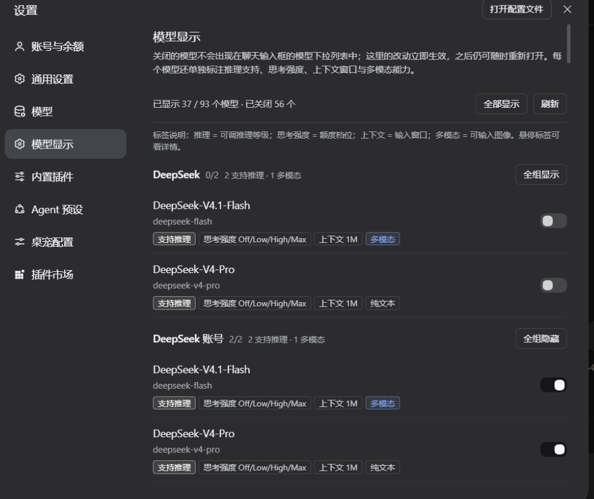

# dsh-model-visibility

在 DeepSeek Harness 的设置里管理「哪些模型出现在聊天输入框的模型菜单中」，按 Provider 分组一键显示/隐藏，并在**每个模型**下面标注它的能力：是否支持推理、思考强度档位、上下文窗口、多模态（图像输入）。

一个 DSH bundle 插件：Host 端负责持久化偏好，并提供只读的模型能力目录；浏览器端过滤模型目录并渲染设置页。它**不接管**输入框的模型座位，因此官方的「模型 / 推理等级」两级菜单、推理等级调整，以及像 `dsh-codex-effort-slider` 那样改造这一行的插件都保持可用。

## 功能

- **设置 → 模型显示**：按 Provider 分组列出全部模型，每个模型一个开关；关闭的模型立即从对话菜单中消失。
- **每个模型独立标注能力**：
  - `支持推理` / `不支持推理` / `推理未知`；
  - `思考强度 Off/Low/Medium/High`（适配器公布的全部档位，默认档位在悬停提示里）；
  - `上下文 1M` / `上下文 200K`（悬停显示精确 token 数）；
  - `多模态`（可输入图像） / `纯文本` / `模态未知`。
- **分组汇总**：每组标题显示 `已显示/总数` 以及 `n 支持推理 · m 多模态`。
- **分组一键开关**：每组标题右侧是「全组隐藏 / 全组显示」，顶部还有「全部显示 / 刷新」和 `已显示 x / y 个模型 · 已关闭 n 个` 汇总。
- **对话菜单只显示开启的模型**：隐藏模型连同变空的分组一起消失；当前会话正在使用的模型即使被关闭也会保留，因为收起态按钮靠这份目录显示模型名。
- **偏好落在 Host 设置文档**：写入 profile 的 `cordis.patch.yml`（`- id: model-visibility → hidden: [...]`），刷新、重启、切换会话都保留，不依赖浏览器本地存储。
- **设置不会因为插件重装/配置层重建而丢失**：Host 端额外把同一份列表镜像到 `$DSH_HOME/dsh-model-visibility/hidden.json`，并用它给 `hidden` 的 schema 默认值播种。详见下方「持久化」。



## 安装

```powershell
# 目录方式（开发）：profile 里 link 这个目录
# 用 plugin_manager 安装：
#   install_bundle   target = D:\code\dsh-model-visibility
```

本地链接安装需要目录里有依赖：

```powershell
npm install
```

安装后刷新页面（或重启 DSH）即可看到「设置 → 模型显示」。

## 能力标注从哪里来

DSH 官方的 `session.modelCatalog` 只把模型 id / 名称 / 推理档位投影给浏览器，**没有**上下文窗口和输入模态。本插件的 Host 端因此注册了一条同源只读路由：

```
GET /api/dsh-model-visibility/models[?fresh=1]
```

它遍历 `ctx.llm.listProviders()` → `listModels()` → `resolveModelInfo()`，把每个模型的：

| 字段 | 来源 | 页面展示 |
| --- | --- | --- |
| `reasoning` | `resolveModelInfo().reasoning` | `支持推理` + `思考强度 ...` |
| `context.contextWindow` | `resolveModelInfo().context` | `上下文 128K` |
| `inputModalities` | `resolveModelInfo().inputModalities` | `多模态` / `纯文本` |
| `defaultMaxTokens` | `resolveModelInfo().defaultMaxTokens` | 仅悬停提示 |

这与官方模型菜单读的是同一份 LLM registry，所以两边不会对「是否支持推理」和「有哪些档位」产生分歧。单模型解析失败不会让整行消失：该行会带 `infoError` 显示为「推理未知 / 上下文未知」，开关仍然可用。

浏览器端优先走这条路由；如果 Host 半还没加载（例如刚升级插件但页面还是旧 Host），会自动退回官方 `session.modelCatalog()`，页面顶部显示「模型能力信息暂不可用」，推理档位仍然可用。

> **关于「合并 dsh-mobile-sync」**：核对过 `D:\code\dsh-android-Conversation sync`（package name `dsh-mobile-sync`）的仓库、历史与全部源码，它是局域网手机同步插件，**不包含**读取思考强度的代码。因此需求里的思考强度 / 上下文 / 多模态 / 是否支持推理是直接实现在本插件里的；插件名保持 `dsh-model-visibility`，也不需要额外安装另一个插件。若以后接的是别的 effort 插件，扩展点见 [`HANDOVER.md`](HANDOVER.md)。

## 结构

| 文件 | 作用 |
| --- | --- |
| `package.json` | bundle 清单、`dsh.client` 声明、`./locale/*.json` 与 `./icon` 导出；含 `npm test` |
| `cordis.patch.yml` | 插入 Host 行 `model-visibility` |
| `index.js` | Host 端：`hidden: string[]`（volatile Config，持久化在设置文档）+ 影子副本 + 能力路由注册 |
| `lib/model-info.js` | Host 端能力探针：校验/裁剪 `resolveModelInfo` 结果、按 Provider 隔离失败、15s 缓存 |
| `client.js` | 浏览器端：设置页（`settings.section`）+ 就地包装 `modelDirectories` 每个目录的 store + 能力标签 |
| `locale/*.json` | 插件列表里的标题与描述 |
| `test/model-info.test.mjs` | 能力探针的单元测试（`node --test`） |
| `icon.svg` | 插件列表图标 |

## 实现要点

### 过滤模型

- 不注册 `conversation.input.model` 座位：官方选择器仍是唯一占位者。过滤发生在会话目录的 store 上——`getSnapshot()` / `subscribe()` 被**就地**替换成过滤版本，因为官方座位可能在本插件加载前就捕获了同一个 store 对象，替换对象本身够不到它。
- 目录来自共享的 `modelDirectories.directoryFor(sessionId)`；插件同时包装该方法，让之后新建的目录也走同一套 store 补丁。
- 隐藏项用 `provider/model` 字符串作为不透明 key，Set 化后同时用于设置页与过滤。
- 设置页的读写走 `ctx.configForms.get('model-visibility')`，与 Host 设置文档保持同一 revision；写入失败会在页面上提示。

### 能力探针

- `createModelInfoService(llm)` 用一条共享的 in-flight Promise 合并并发读；默认 TTL 15s，`?fresh=1` 绕过 TTL（刷新按钮与 `llm/adapters-updated` 使用）。
- `llm/adapters-updated` / `settings/document-updated` 在 Host 端清缓存；浏览器端在同样的事件上重新拉取。`settings/document-updated` 用普通读而不是 fresh 读，因此「隐藏一个模型」这次设置写入会命中缓存，不会导致 90+ 个模型全量重探。
- 某个 Provider 的 `listModels` 抛错时，该组从结果中移除并出现在 `failures` 里；页面用一条提示列出这些 Provider（悬停看原因），不影响其他组。
- 所有字段都是可选的：适配器不知道的事实就显示「未知」，不猜。

## 持久化

`cordis.patch.yml` 是「用户覆盖层」，DSH 会整层重建它：

- profile 自愈（`sanitizeProfile`）会把整份 patch 改名成 `.bak-<ts>` 后从空文件重来；
- 插件重装 / 升级会重置该行的 `config`；
- 设置写入时若新值等于继承值（例如隐藏列表为空），DSH 会直接删掉这一行。

任何一种发生，`hidden` 都会退回默认值 `[]`，表现出来就是「插件重新加载后所有模型又都显示了」。

所以 Host 端做了两件事：

1. **镜像**：每次 `hidden` 变化（`loader/volatile-update` / `settings/document-updated`）都原子写入
   `$DSH_HOME/dsh-model-visibility/hidden.json`；插件加载和卸载时各同步一次。
2. **恢复**：`hidden` 的 schema 默认值在模块加载时从该文件读取，所以 patch 层被清空后，
   插件重新加载得到的是上次的列表而不是空列表。

存储文件缺失或损坏时按空列表处理，行为与之前一致；需要重置时删掉该文件即可。
文件是全局的（不按 profile 区分），多个 profile 共用同一份隐藏列表。

## 测试

```powershell
npm test
```

覆盖：推理档位清洗、默认档位校验、模态去重、单模型解析失败降级、Provider 失败隔离、缓存 TTL / `fresh` / `invalidate`、并发共享。

GUI 冒烟测试（改完代码后）：

1. 改 `client.js` → 页面 `Ctrl+R`，打开 设置 → 模型显示，确认标签渲染、开关生效。
2. 改 `index.js` / `lib` → 需要 Host 重载：重启 DSH，或让 profile 重新组合（桌面版 HMR 会在下一次 profile 重组时替换已改动的已链接包）。重载后确认页面顶部不再出现「模型能力信息暂不可用」。
3. 打开对话输入框的模型菜单，确认被关闭的模型没有出现、当前模型仍显示。

## 已知限制

- 能力完全取决于适配器公布什么；`resolveModelInfo` 不返回的字段只能显示「未知」。
- 上下文按十进制缩写（262144 → `262.1K`），精确值在悬停提示里。
- 目录是实时注册表快照；如果某个动态免费模型源刚好在刷新，页面模型总数可能和输入框里较旧的目录缓存略有出入，点「刷新」即可对齐。
- 设置页没有搜索/筛选/排序；模型很多时依赖分组浏览。要做的话直接在 `client.js` 的 `makeSection` 里加。

## License

MIT
