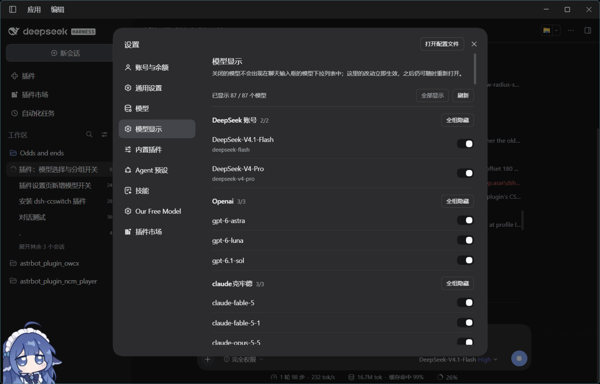

# dsh-model-visibility

在 DeepSeek Harness 的设置里管理「哪些模型出现在聊天输入框的模型下拉中」，并把关闭的模型按 Provider 分组一键显示/隐藏。

一个 DSH bundle 插件：Host 端只负责把偏好持久化进设置文档，浏览器端接管输入框的模型座位（`conversation.input.model`）并新增一个设置页。

## 功能

- **设置 → 模型显示**：按 Provider 分组列出全部模型，每个模型一个开关；关闭的模型立即从对话下拉中消失。
- **分组一键开关**：每组标题右侧是「全组隐藏 / 全组显示」，顶部还有「全部显示 / 刷新」和 `已显示 x / y 个模型 · 已关闭 n 个` 汇总。
- **对话下拉只显示开启的模型**：隐藏模型连同变空的分组一起消失；模型多于 6 个时出现搜索框，支持 ↑/↓、Enter、Esc，选中后写回当前会话。
- **偏好落在 Host 设置文档**：写入 profile 的 `cordis.patch.yml`（`- id: model-visibility → hidden: [...]`），刷新、重启、切换会话都保留，不依赖浏览器本地存储。



## 安装

```powershell
# 目录方式（开发）：profile 里 link 这个目录
# 用 plugin_manager 安装：
#   install_bundle   target = D:\code\dsh-model-visibility
```

本地链接安装需要目录里有依赖：

```powershell
npm install
```

安装后刷新页面（或重启 DSH）即可看到「设置 → 模型显示」。

## 结构

| 文件 | 作用 |
| --- | --- |
| `package.json` | bundle 清单、`dsh.client` 声明、`./locale/*.json` 与 `./icon` 导出 |
| `cordis.patch.yml` | 插入 Host 行 `model-visibility` |
| `index.js` | Host 端：`hidden: string[]`（volatile Config，持久化在设置文档） |
| `client.js` | 浏览器端：设置页（`settings.section`）+ 输入框模型座位（`conversation.input.model`，`priority: -1`） |
| `locale/*.json` | 插件列表里的标题与描述 |
| `icon.svg` | 插件列表图标 |

## 实现要点

- 模型目录来自 Host 的 `session.modelCatalog()`；下拉的当前选择/切换复用共享的 `modelDirectories` 服务（`directoryFor(sessionId)` 的 store、`load`、`select`），因此只有列表被过滤，选择与推理等级逻辑仍走原厂实现。
- 隐藏项用 `provider/model` 字符串作为不透明 key，Set 化后同时用于设置页与下拉。
- 设置页的读写走 `ctx.configForms.get('model-visibility')`，与 Host 设置文档保持同一 revision；写入失败会在页面上提示。

## License

MIT
