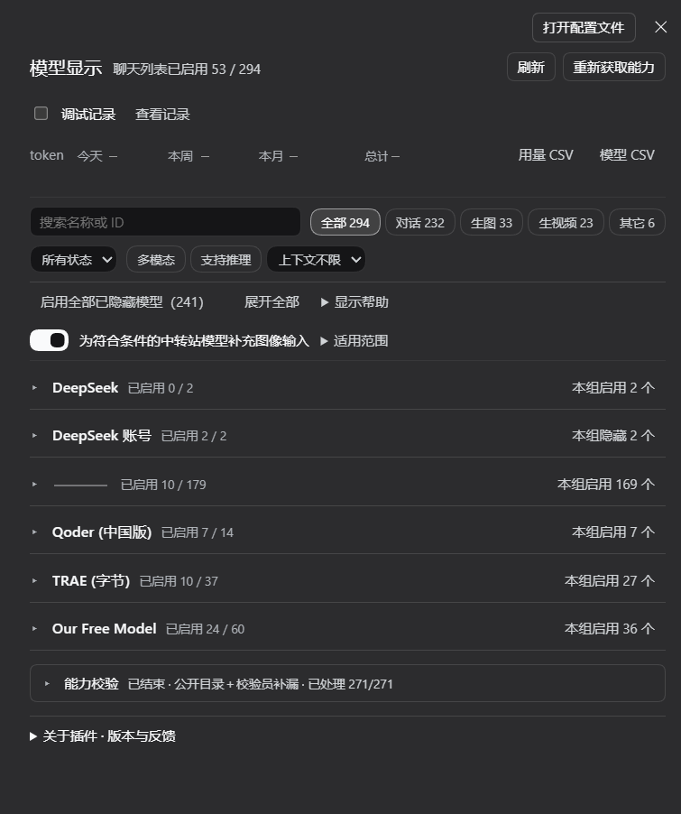

<div align="center">

# 模型显示

**让 DeepSeek Harness 的模型菜单更干净，让每个模型的能力更清楚。**

显示或隐藏模型 · 辨认真实能力 · 手动修正声明 · 让多模态模型真正能发图

[](LICENSE)
[](package.json)
[](https://github.com/TZYCeng/dsh-model-visibility/actions/workflows/ci.yml)

[安装](#安装) · [使用指南](#使用指南) · [能力来源](#能力来源与可信度) · [联网校验](#联网校验) · [故障排查](#故障排查) · [开发文档](HANDOVER.md)

</div>

---

## 它解决什么问题

DSH 的标准模型目录主要提供模型 ID、名称与推理档位。对于自定义中转站，未填写的 `input` 经常回退为 `defaultInput: [text]`，于是可能出现：

- 模型菜单混有生图、生视频、嵌入等不需要的条目；
- 实际支持图片的模型被标成纯文本，发送图片时被拒绝；
- 上下文窗口、输入模态和推理档位难以辨认；
- 不同中转站对同一个模型的声明不完整，甚至互相矛盾。

这个插件把模型清单变成一个**可筛选、可解释、可修正的管理页面**，同时保留官方模型选择器及其推理档位控件。

## 界面



*设置 → 模型显示。上图为真实使用环境，模型数量与用量来自用户配置。*

## 功能一览

| 功能 | 说明 |
| --- | --- |
| **逐模型开关** | 隐藏的模型立即从对话输入框的模型菜单消失；当前会话正在使用的模型仍保留，避免触发器丢失名称。 |
| **分组管理** | 按 Provider 分组，支持整组显示/隐藏、折叠/展开；筛选时只处理筛选结果。 |
| **搜索与筛选** | 按名称或 ID 搜索；按启用/未启用（仅指模型菜单可见性）、类型、多模态、推理能力和最小上下文窗口组合筛选。 |
| **能力标签** | 展示模型类型、输入模态、上下文窗口、推理能力与档位；实线表示声明，虚线表示补全或推断。 |
| **手动覆盖** | 为单个模型编辑类型、模态、上下文和推理档位；可只保存在本插件，也可写回 Provider 配置。 |
| **图像放行** | 默认开启。对判定支持图像的中转站对话模型，在内存中补充 `image`，同时覆盖发送准入和请求序列化。 |
| **联网校验** | 汇总公开目录，再由用户选择的校验员模型补充能力信息；支持分批、并发、取消和失败诊断。 |
| **用量统计** | 显示今天、本周、本月与保留窗口内的合计 Token，支持用量和模型清单 CSV 导出。 |
| **持久化恢复** | 隐藏列表、手动覆盖、学习快照与账本缓存分别保存在 `$DSH_HOME/dsh-model-visibility/`。 |

## 安装

### 插件市场

打开 [awesome-dsh-plugin 中的插件页](https://awesome-dsh-plugin.com/p/TZYCeng/dsh-model-visibility/)，按市场流程安装。

### DSH `plugin_manager`

```text
install_bundle  target = @tzyc/dsh-model-visibility
```

也可安装最新 Release 包：

```text
https://github.com/TZYCeng/dsh-model-visibility/releases/latest/download/dsh-model-visibility.tgz
```

### 本地开发

```powershell
git clone https://github.com/TZYCeng/dsh-model-visibility.git
cd dsh-model-visibility
npm ci
npm test
npm run build
```

在 DSH profile 中链接此目录。安装或更新后刷新页面；Host 代码更新时需要重新加载 Host 或重启 DSH。

> npm 包名是 **`@tzyc/dsh-model-visibility`**。不带作用域的 `dsh-model-visibility` 是另一个项目。

## 使用指南

### 清理模型菜单

1. 打开 **设置 → 模型显示**。
2. 用搜索或类型筛选找到目标模型。
3. 关闭单行开关，或使用「全组隐藏」批量处理。
4. 回到对话输入框，确认模型菜单已更新。

「全部显示」会清空隐藏列表；「折叠全部」只改变页面的阅读状态，不改变模型可见性。折叠偏好保存在浏览器 `localStorage`，不会同步到 Host。

### 修正能力声明

点击模型行的「编辑」，可设置：

- 类型：对话、生图、生视频、嵌入、重排、音频、审核、翻译；
- 输入模态：文本、图像、音频、视频、文件；
- 上下文窗口；
- 推理档位及默认档，或明确声明不支持推理。

留空并保存等价于删除本地覆盖，恢复自动识别。

#### 一键填入参考档位

1. 对有参考档位的对话模型，打开「编辑能力 → 填入参考档位」。预览来源、拟填的档位和警告，选「确认填入草稿」。这一步不保存、不发送请求，也不更改 Provider。
2. 检查档位后可直接「保存到本插件」。如果要用于对话，须勾选「同时写入模型提供商设置」，检查映射，再确认保存并写入。仅对 Host 确认符合条件的 OpenAI Completions 路由，另行勾选标准 `reasoning_effort` 后，才用同名值补空白映射。其他协议须提供准确的请求值；`off`、`none` 和非标准档位不会被自动转成同名请求值。
3. 实际写入只针对当前路由的现有模型条目。保留已有映射和显式关闭的推理设置；不支持、写回受保护或未确认生效的项目仍可能只保存在本地。保存回执会区分。公开目录、别名和适配器参考不是实测；即使写入成功，网关仍可能忽略参数、拒绝请求或改变延迟、Token 用量与费用。建议先用短对话检查；如有问题，到 Provider 设置撤销。

编辑默认只保存到本插件。勾选「同时写入模型提供商设置」后，才尝试写入 Provider 的现有模型条目：仅支持文本/图像的输入声明、上下文窗口，以及有明确上游映射的推理档位。不支持或未完全写入的字段仍留在本地。已有的显式上游值可复用；新增档位请按该路由的 API 文档填写对应值，插件不会用档位名称猜测。

> 「恢复自动」不会撤销已经写进 Provider 配置的值。要撤销写回，请到模型提供商设置中修改对应字段。

### 让多模态模型接收图片

保持「让输入框按能力标注放行图像」开启即可。插件只包装符合 pi-ai 形状的适配器，且只处理中转站对话模型的 `image` 输入：

- 显式 Provider 声明优先，包括内置目录的 `modelOverrides`；不改写内置目录自身的输入能力；
- 不修改路由配置文件；
- 关闭开关或卸载插件后恢复；
- 不会让音频、视频或文件绕过 DSH 的准入限制。

### 刷新与重新获取能力

- **刷新**：绕过能力快照与中转站探测的 TTL，但会复用正在进行的读取。
- **重新获取能力**：使能力、探测、覆盖和图像准入缓存失效，丢弃旧的进行中结果，再重新读取；不会改变隐藏开关。

「可选思考强度」来自当前适配器；「参考档位」来自快照或本地编辑，不会改变对话菜单、默认档位或请求。要启用实际档位，请为该路由配置准确的上游映射。对 OpenAI Completions，若 API 确实接受 `reasoning_effort`，还要确认提供商兼容设置未禁用 `supportsReasoningEffort`。Responses、Anthropic 等协议可能用不同字段；未选档或 Off 也可能按协议省略字段。已经写入的旧配置不会被插件自动猜测或迁移。对标准 OpenAI Completions 中转模型，可在「编辑能力」选择 `minimal`、`low`、`medium`、`high`、`xhigh` 或 `max`，也可以先点「载入已有档位」而后删掉上游不支持的档位。勾选「同时写入模型提供商设置」及「让此模型发送标准 reasoning_effort」。确认上游支持该字段及实际使用的值后再保存；空白映射才会补同名值，不覆盖已有映射。对通过协议校验的路由，保存时会同时锁定此模型的标准思考格式并启用该字段。没有明确档位的模型不会自动得到四档。保存后在对话选择对应档位；本地参考默认档位不影响请求。

## 能力来源与可信度

每个字段独立合并，不是整条记录只选一个来源。

| 优先级 | 来源 | 页面含义 |
| --- | --- | --- |
| 1 | `manual` | 用户手动声明；始终优先。 |
| 2 | `config` | Provider 或模型条目中显式配置的能力。 |
| 3 | `adapter` | 内置适配器或非配置列表模型的适配器声明。 |
| 4 | `provider` | 中转站 `/models` 或 `/api/pricing` 返回的能力。 |
| 5 | `snapshot` | 联网校验保存的学习快照；以虚线显示。 |
| 6 | `inferred` | 根据明确的模型家族名称推断；以虚线显示。 |
| — | `unknown` | 没有足够证据，保持未知。 |

`official` 是独立的厂商文档校正层：可修正中转站、快照或名称推断中的错误，但不压过用户的显式配置和内置适配器声明；`manual` 始终最高。

**重要边界：** `input: []` 表示未声明，不等于纯文本；`defaultInput: [text]` 也不会被当成模型真实能力的证明。

## 联网校验


### 选择核验方式

| 方式 | 公开目录 | 校验员 |
| --- | --- | --- |
| **只用公开目录** | 按名称匹配已配置的模型并导入 | 不调用模型、不搜索网页、不写 Provider |
| **公开目录＋校验员补漏**（默认） | 先导入匹配到的模型 | 只联网查没有匹配到的模型；全部命中时不调用校验员 |
| **仅校验员联网** | 不下载、不合并公开目录 | 重查全部其他模型，包括已有记录；不查校验员自身 |

默认优先按完整 ID 匹配。「允许别名匹配」会按厂商、中英文名称、大小写和标点查找；没有直接命中时，会继续去掉 `preview`、`27b`、日期、尺寸、`fast`、`free` 等尾部限定。例如「千问4 max .preview」「千问四max」都可以找到 `qwen4-max`。原 ID 和模型版本不会被改名，精确命中优先，同级冲突则不猜。归一化结果只作参考，不会自动写回或放行图像。

models.dev 用规范模型 ID 和各 Provider 公布的档位；OpenRouter 读取其模型 ID、规范 slug 和显式档位；Hugging Face 按 `owner/repo` 匹配任务和标签，不把其他作者的同名仓库当成原厂模型。目录档位会标为「目录参考档位」，不是当前路由的可选档位。更新后运行一次「只用公开目录」即可刷新旧快照；单纯的「重新获取能力」不会下载目录。

前两种方式默认跳过已有记录，可在「高级选项」勾选重查。允许写回时，也只补齐可确认的 Provider 空白模态和上下文，不覆盖已有声明。**模型及联网工具可能消耗额度**。进度会区分目录匹配和交给校验员的模型数量，详细来源与失败原因可展开查看。

### 这不是实际请求测试

联网模式下，校验员依据搜索摘要与可选的文档原文给出结果，**不等于插件真的向目标模型发送图片或测量上下文长度**。结果中的 `evidence` 保存 URL 与其支持的字段；代码只接受本批次检索返回的 URL，并删除没有引用支持的字段。这个检查能阻止虚构地址，仍不能自动证明引用内容与结论完全一致。不需要模型或搜索时，选择「只用公开目录」。

因此：

- 把学习快照视为**可修正的参考信息**，不要视为不可变事实；
- 开启写回前，先检查重要模型的结果；
- 对关键模型，仍应手动发送一次图片或查看厂商文档；
- 较旧的校验批次只能补充空缺，不能覆盖较新的能力声明。

### 失败处理

- 校验优先使用适配器公布的 `off`，否则选 `minimal` 或最低可选档位；没有档位元数据时沿用 Adapter 默认。上游仍可能把隐藏推理计入 8192 Token 输出预算，插件丢弃推理流，但不能替上游关闭思考；
- 联网检索与最终输出分开：最终请求没有工具或历史推理，只带模型 ID 和有内容的证据。插件只收集最终正文。未知字段可以省略；不合法或无引用的字段单独丢弃，不牵连有效信息。只有 ID 不明或没有可用字段的条目才需要修复。
- 截断时保留完整有效条目，将未回答项最多拆成两组，继续复用原证据，不反复搜索，也不缩减留给上游的输出余量；普通格式错误做一次定向修复。
- 首次资料收集若耗尽思考预算，公开目录已确认的模型 ID 可补发最多两组搜索。只有未确认 ID 时，校验员可再做一次精简的工具请求。每批共用 360 秒，单次模型请求最多 180 秒，单次搜索或读取最多 30 秒。常规资料收集最多 4 轮、12 次工具调用。
- 公开目录即使在校验员无答案时，也能独立落库；`models.dev/api.json` 在瞬时下载失败时会有界重试一次，持续失败时其余来源照常可用；
- 取消会等待旧 worker 退出，避免两轮任务同时写状态。部分 Free Search 版本不支持中断已发出的上游搜索：校验员会停止等待，不再使用迟到结果，旧调用结束前不会再发起 Free Search 请求；
- 插件卸载会取消并等待校验任务，不会在后台继续落库。已提交给宿主的 Provider 配置写入无法撤销，取消只阻止后续写入；尚未返回的写入会标为待定，结算后单独报告。

## Token 用量与 CSV

插件优先通过 DSH 的只读会话存储读取日志，遵循宿主配置的会话目录；服务不可用时才读取默认目录的当前格式日志。

- 保留最近约 **14 个月**，按每次请求实际发生的日期和路由统计。无法读取的会话会显示提示；已有可用统计时保留其最后一次完整结果。
- fork 会话只计入自身新增消耗，不重复统计继承历史。旧账本缓存会重扫，已保存的校验用量保留。
- 校验自身的消耗也计入总量，并在没有用量扫描时独立保存。
- 冷启动导出等待扫描完成；CSV 的按模型分解标明统计日期范围。

CSV 会转义分隔符、引号与换行，并防护表格公式注入。模型清单 CSV 的 `reasoning` 列是合并后的能力记录，用 `sources` 判断来源；它不是适配器实际可选档位或请求参数的清单。

## 数据与隐私

| 数据 | 位置 |
| --- | --- |
| 隐藏列表 | DSH 设置 + `$DSH_HOME/dsh-model-visibility/hidden.json` |
| 手动覆盖 | `overrides.json` |
| 学习快照 | `learned.json` |
| 用量缓存 | `usage-ledger.json` |
| 折叠、说明和校验员选择 | 浏览器 `localStorage` |

- 凭据只在 Host 内解析，用于请求对应 Provider；不写入插件文件、不返回浏览器、不记录到诊断。
- 中转站探测仅允许 HTTPS；HTTP 只放行 localhost、127.0.0.1 和 ::1。
- 请求不跟随重定向，避免把认证头带到其他域。
- 中转站响应限制 4 MiB，公开目录限制 16 MiB，按实际字节流读取，超限即取消。
- 多份数据文件是全局的，不按 DSH profile 隔离；不建议多个 Host 实例同时写同一份文件。

关闭中转站探测：将插件配置设为 `probe: false`，或设置环境变量 `MODEL_VISIBILITY_PROBE=0`。

## 故障排查

| 现象 | 建议 |
| --- | --- |
| 页面退回基础模型目录 | Host 路由尚未加载或读取失败。重新加载 Host/重启 DSH 后，再点「重新获取能力」。 |
| 模型仍显示纯文本 | 检查 Provider 是否显式配置了 `input: [text]`；必要时用「编辑能力」修正。 |
| 页面显示多模态但仍不能发图 | 确认放行开关已开启、路由属于 pi-ai 中转站，并重新加载 Host；再用真实小图验证。 |
| 推理档位为空 | 适配器未公布该信息。区分参考与可选档位。若确需在对话里选择，请按当前路由协议设置明确的上游映射并检查兼容开关；联网校验不会写推理配置。 |
| 中转站显示读取失败 | 悬停分组徽标查看 DNS、超时、鉴权或 TLS 诊断；`/api/pricing` 返回 403/404 属常见降级。 |
| 校验批次失败 | 查看面板的真实错误；换非思考型校验员、降低并发，或稍后重试。 |
| 隐藏列表在重装后恢复 | 删除 `hidden.json` 可重置；该文件正是用于跨 profile 修复和插件重装恢复偏好。 |

更多已知约束：只处理 pi-ai 的图像准入；官方校正是手工维护的小表；冷门模型仍需手动补充；大规模会话日志的首次扫描可能耗时数秒至数十秒。

## 开发与测试

```powershell
npm test          # 全量自动化测试
npm run build     # client-src/*.mjs → client.js
npm pack --dry-run
```

浏览器源码位于 `client-src/`，`client.js` 是构建产物，不要直接手改。Host 与核心逻辑位于 `index.js` 和 `lib/`。

架构、接口契约、修改指引、验证与发布清单见 **[HANDOVER.md](HANDOVER.md)**。

## License

[MIT](LICENSE)
