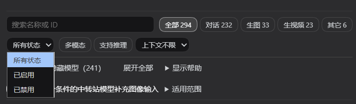
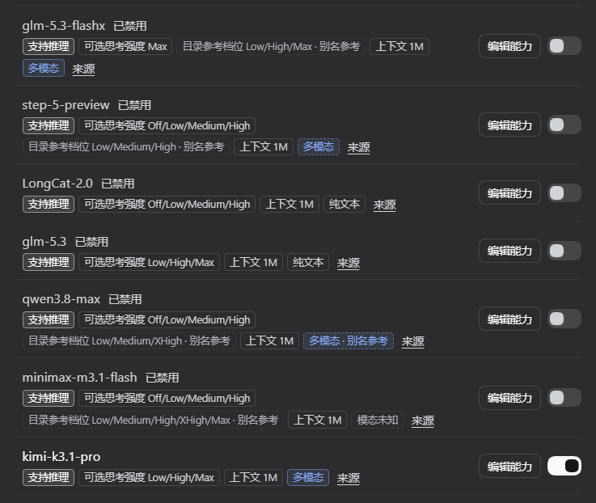
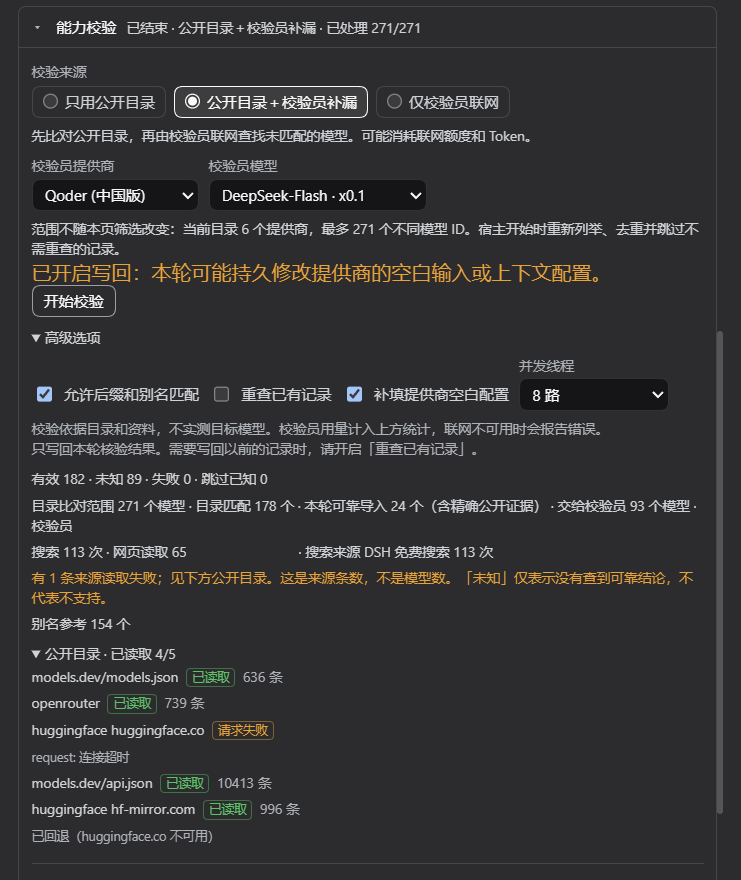

# 模型显示 · Model Visibility

  

把 DeepSeek Harness 的聊天模型菜单整理成常用清单，并看清每条路由的能力来源。**菜单可见性、当前路由可选档位、公开资料参考**是三个不同的概念；插件会分开显示。

> **维护状态：v1.16.1 是归档前的最后一个维护版。** 仓库名和 npm 包名不变，保留现有的模型显隐、能力目录与用量功能。不需要新增能力的用户可以继续安装和使用本版，无需迁移。后续开发转到 [DSH-The-Model-List](https://github.com/TZYCeng/DSH-The-Model-List)，计划探索多协议转换、将上游 thinking 与最终正文分离，以及可选的响应兼容层；本版不加入这些变化，也不会自动切换到新项目。

[快速开始](#快速开始) · [读懂标签](#读懂标签) · [能力校验](#能力校验) · [排障](#排障) · [开发与发布](HANDOVER.md) · [v1.16.1 发布说明](docs/RELEASE-1.16.1.md)

*实机截图，已遮盖自定义提供商名称和账户用量数值。部分标签以当前版本文案为准。*

## 快速开始

1. 在 DSH 插件管理器中安装 **`@tzyc/dsh-model-visibility`**，或从 [GitHub Releases](https://github.com/TZYCeng/dsh-model-visibility/releases) 下载安装包，也可添加本地开发目录。更新后重启 DSH Host，再刷新页面；只刷新页面不会替换运行中的 Host 模块。
2. 打开 **设置 → 模型显示**。按名称或 ID 搜索，或按模型类型、菜单可见性、图像输入、推理或上下文筛选。切换单个模型，或确认后批量显隐；**只改确认清单里的目标**。隐藏不会停用提供商，也不会踢掉当前会话正在使用的模型；该会话切走后，它才从菜单消失。
3. 点 **编辑能力** 修改类型、输入、上下文或推理档位。**保存到本插件**只存本地覆盖；**写入提供商**才尝试修改现有路由配置。标准兼容路由可填缺失的同名档位，已有映射会保留；非标准协议请按路由文档填写真实请求值，不要猜。回执分别说明已写、沿用、仅本地与未核实；「恢复自动」不会撤销写进提供商的值。

查看聊天菜单可见性筛选

## 读懂标签

| 标签 | 怎么读 |
| --- | --- |
| **菜单可见 / 菜单隐藏** | 只管聊天模型菜单，不是路由是否已启用，也不是访问权限。 |
| **对话可选** | 当前适配器实际向聊天选择器报告的档位；不保证上游接受每个请求值。 |
| **目录档位 / 参考档位 / 别名参考** | 公开目录或学习快照提供的参考。别名不是精确 ID；这些标签本身不会改变聊天请求。 |
| **上下文 / 图像输入 / 纯文本 / 输入未知** | 总结该字段的已知资料。**没有资料不等于不支持**；图像输入标签也不等于当前中转路由已经实测可发图。 |

展开模型行的 **能力来源** 查看各字段依据和可用链接。手工设置、提供商显式配置及可信原生适配器声明优先；缺项才用厂商校正、精确公开目录、中转站清单、学习快照或名称推断。图像准入只补充符合条件的 pi-ai 中转对话路由；明确的纯文本声明不会被扩宽。模糊别名、名称猜测和归属不明的同名路由快照只作参考，不能授权附图。

## 能力校验

**刷新 / 重新获取能力**只重新读当前目录、配置和中转站元数据，不清筛选，也不重跑校验员。**能力校验**才更新学习快照，范围不受页面筛选限制；相同 ID 跨路由去重，开始时重新列举。

| 来源模式 | 会做什么 |
| --- | --- |
| **只用公开目录** | 读取 models.dev、OpenRouter、Hugging Face 等公开资料。不调用校验员，不使用网页搜索服务。 |
| **公开目录＋校验员补漏** | 先找目录条目，仅将仍需核验的目标交给选定模型；可能消耗模型 Token 和搜索额度。普通增量不会因为已核验模型没公布推理档位就重复调用校验员。 |
| **仅校验员联网** | 不读取公开目录，用校验员和搜索服务检查目标（不检查校验员自己）；可能消耗更多额度。 |

这次实测 **271/271 已处理：182 有效、89 未知、0 个模型失败**。另外，Hugging Face 主站超时，镜像读取成功；这是**一个来源尝试失败**，不是一个模型失败。引用代表资料来源，不等于实际调用目标模型。

查看来源回退示例

校验员最终答案使用批内短编号，宿主映射回完整 ID。若漏行，保留有效行，仅补未通过校验的目标。长 ID 批次或明确截断时最多拆成两组补答，每个未解决目标最多补一次，不重新搜索。补答后仍无有效行会计入失败；主动返回“未知”则不是失败。

### 两种写回不要混用

- 高级选项 **补填提供商空白配置**：尝试写入本轮经过校验、且与最终能力来源一致的空白输入或上下文字段。仅做目录核验或诊断时，保持关闭。
- **一键填入已查到的思考档位**：先生成本地预览，只有确认才授权写入当前清单中协议兼容、归属与证据明确的目标。开启后，用户主动完成的后续核验可在授权范围内继续补缺；新增目标或关键配置变化需要重新确认。开关本身不会运行校验员。关闭或重启 Host 停止新写入，不撤销已完成或已派发的请求。

## 用量、调试与本地数据

- **Token 与 CSV**：统计今天、本周、本月与保留期内累计，缓存读写单独计列；支持用量和模型目录 CSV。这不是供应商账单。
- **调试记录**默认关闭。先开启再复现，结束后可查看或复制近期记录。仅记录步骤、限定格式的标识、字段名和处理结果，不记录密钥、认证头、对话、原始请求正文或上游映射值。**分享前检查自定义路由、模型名和路径。**
- **关于插件 · 版本与后续开发**：显示当前 Host 版本；展开时查询旧包的 npm `latest`，不自动更新。后续项目链接只打开 GitHub，不发送本地数据。
- **数据存储**：有独立 profile 的 Host 使用 `$DSH_HOME/dsh-model-visibility/profiles/<profile-hash>/`。旧隐藏偏好、覆盖与快照按需复制，原件保留；不能归属的旧共享核验消耗不会混入当前 profile。没有 profile 路径时沿用旧目录。

## 排障

| 现象 | 先检查 |
| --- | --- |
| 更新后显示旧功能，或用量、覆盖和调试同时 HTTP 400 | 重启 Host，再刷新页面；仅刷新不会加载修正后的 Host 路由。 |
| 已隐藏的模型仍在当前会话 | 切到其他模型后再查看菜单；已有会话选择受到保护。 |
| 目录有档位，但对话不可选 | 查「能力来源」，确认是参考还是适配器的实际声明；检查写回回执。 |
| `missing ids`、部分未知、单个目录读取失败 | 确认运行结果中的模型失败数和各来源状态。优先用补漏模式、不要启用全量重查或写回做排障。没有资料不要当成能力不存在。 |
| 写回结果未核实 | 先查对应提供商当前配置与回执，不要立即重复提交。 |

旧版开发、架构与发布记录见 [HANDOVER.md](HANDOVER.md)。旧仓库仅供查阅；后续开发请访问 [DSH-The-Model-List](https://github.com/TZYCeng/DSH-The-Model-List)。许可证：[MIT](LICENSE)。
